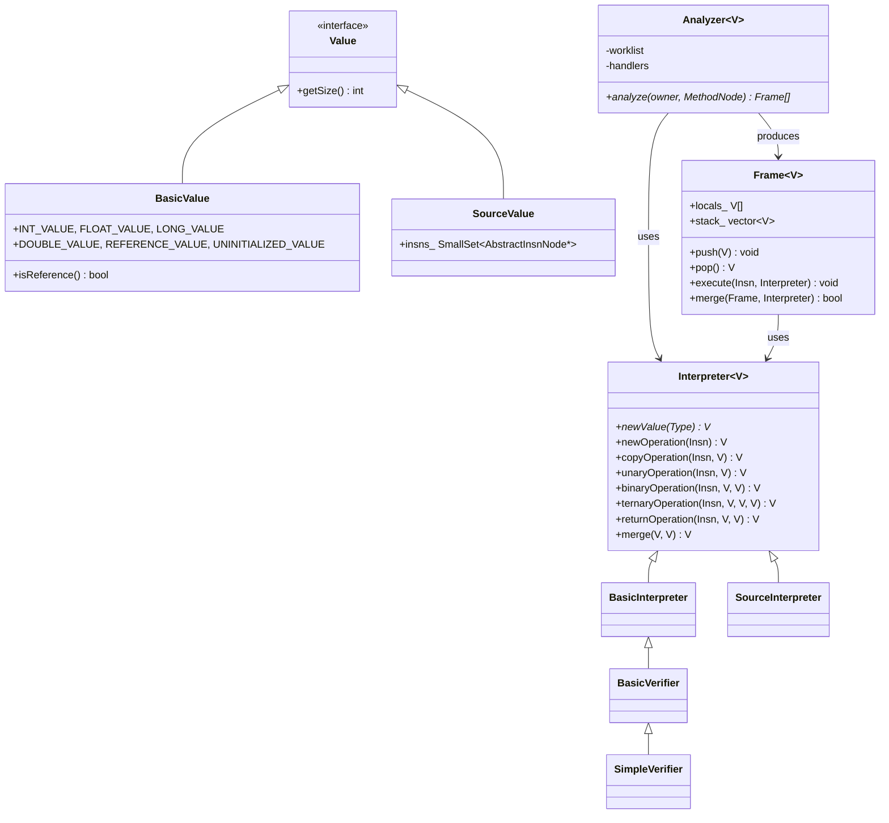
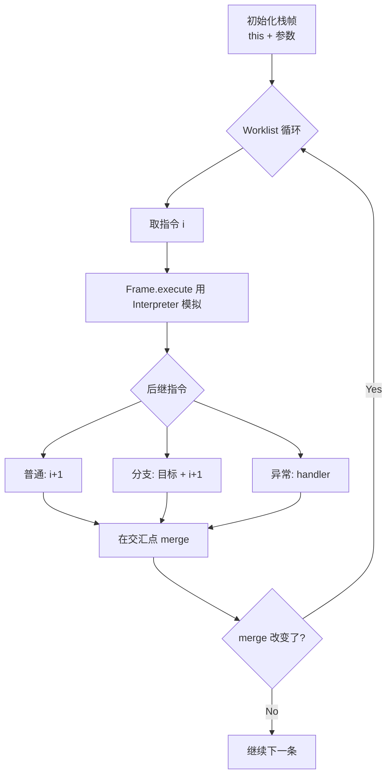

# Analysis 设计

## 概述

Analysis（`jbytecode::analysis`）提供基于 ASM 分析框架的数据流分析引擎：
类型推断、字节码验证、指令来源跟踪。对标 ASM 的 `org.objectweb.asm.tree.analysis`。

需要 Tree API 的 `MethodNode`（CFG 基于指令链表构建）。

## 类关系



## 分析流程



### Interpreter 选择

| Interpreter | 输出 Value | 用途 |
|-------------|-----------|------|
| `BasicInterpreter` | `BasicValue`（类型类别：INT/FLOAT/REF/...） | 栈帧形状分析、maxStack/maxLocals 验证 |
| `BasicVerifier` | `BasicValue` | JVM 字节码验证规则（操作数类型匹配） |
| `SimpleVerifier` | `BasicValue` | 类层次感知的精确验证（可配置 ClassLoader） |
| `SourceInterpreter` | `SourceValue`（产生该值的指令集合） | 死代码检测、数据流追踪、def-use |

## 关键 API

### Analyzer

```cpp
template <typename V>
class Analyzer {
public:
    explicit Analyzer(Interpreter<V>* interpreter);
    std::vector<Frame<V>*> analyze(ca::str::Utf8StringRef owner,
                                    tree::MethodNode* method);
    // analyze 返回 frames[i] = 指令 i 处的栈帧（nullptr 表示不可达）
};
```

### Frame

```cpp
template <typename V>
class Frame {
public:
    static Frame newFrame(int nLocals, int nStack);
    void push(V value);
    V    pop();
    V    getLocal(int i) const;
    V    getStack(int i) const;
    int  getStackSize() const;
    // execute() + merge() 由 Analyzer 内部调用
};
```

### 自定义 Interpreter

```cpp
class MyInterpreter : public Interpreter<MyValue> {
    MyValue* newValue(core::Type* t) override;
    MyValue  unaryOperation(tree::AbstractInsnNode* insn, MyValue* v) override;
    MyValue  merge(MyValue* v1, MyValue* v2) override;
};
```

## minidemo

```cpp
ca::str::Utf8StringArena arena;
tree::ClassNode          cn;
ClassReader              reader(arena, data, len);
reader.accept(&cn, 0);

for (auto* method : cn.methods) {
    SimpleVerifier verifier;
    Analyzer<BasicValue> analyzer(&verifier);
    auto frames = analyzer.analyze(cn.name, method);
    // frames[i] 包含指令 i 处的栈帧（nullptr = 不可达/死代码）
}
```
