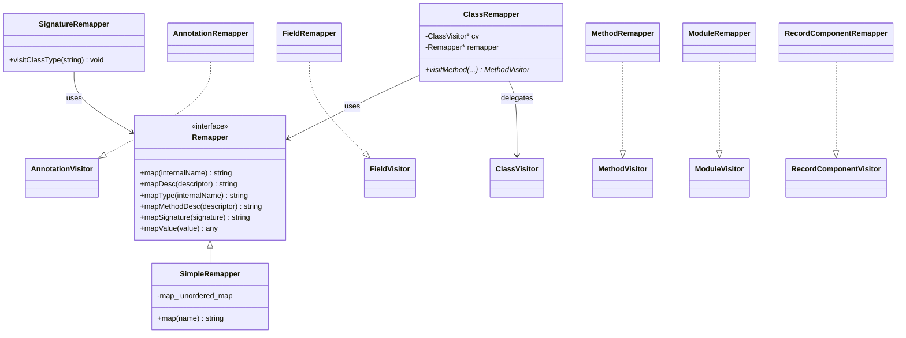
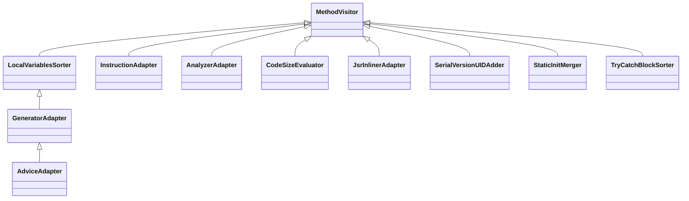

# Commons 设计

## 概述

Commons（`jbytecode::commons`）在 Core/Tree API 之上提供实用的 Visitor 包装器：
类名重映射、代码生成、局部变量重排、静态块合并等。对标 ASM 的
`org.objectweb.asm.commons`。

## Remapper 体系



## Adapter 继承链



| Adapter | 作用 |
|---------|------|
| `InstructionAdapter` | 用方法名（如 `load`/`store`/`add`）代替裸 opcode 的友好生成器 |
| `GeneratorAdapter` | 高层代码生成（`iconst`/`push`/`ifCmp`/`newInstance`/`getTableSwitch`），内置 `LocalVariablesSorter` |
| `AdviceAdapter` | 在方法入口/构造器 super 调用后注入代码（AOP 切面） |
| `AnalyzerAdapter` | 用 Analysis 引擎实时计算当前栈帧，供 visitor 查询 |
| `LocalVariablesSorter` | 重排局部变量槽位（用于插桩后避免槽位冲突） |
| `CodeSizeEvaluator` | 统计生成的字节码大小 |
| `JsrInlinerAdapter` | 内联 JSR/RET 子程序（消除遗留子程序指令） |
| `SerialVersionUIDAdder` | 计算/注入 `serialVersionUID` 字段（基于 SHA-1） |
| `StaticInitMerger` | 合并多个 `<clinit>` |
| `TryCatchBlockSorter` | 按规范排序异常表 |

## 关键 API

### SimpleRemapper + ClassRemapper

```cpp
// 类名重映射：old → new
std::unordered_map<std::string, std::string> mapping = {
    {"org/old/Foo", "org/new/Foo"},
    {"org/old/Bar", "org/new/Bar"},
};
ClassRemapper cr(&writer, new SimpleRemapper(mapping));
reader.accept(&cr, 0);   // reader → ClassRemapper → writer
```

### GeneratorAdapter

```cpp
GeneratorAdapter gen(mv, /*access=*/access, /*name=*/name, /*desc=*/desc);
gen.iconst(42);
gen.visitMethodInsn(Opcodes::INVOKESTATIC, "Main", "run", "(I)V", false);
gen.returnValue();
gen.endMethod();   // 触发 visitMaxs（自动计算）
```

### AdviceAdapter

```cpp
class TraceAdvice : public AdviceAdapter {
    void onMethodEnter() override { /* 方法入口注入 */ }
    void onMethodExit(int opcode) override { /* 每个 return 前注入 */ }
};
```

## minidemo

```cpp
// 类名重映射
ClassReader reader(data, len);
ClassWriter writer;
ClassRemapper remapper(&writer, new SimpleRemapper("org/old/Foo", "org/new/Foo"));
reader.accept(&remapper, 0);
auto out = writer.toByteArray();

// 代码生成
GeneratorAdapter gen(mv, access, name, desc);
gen.iconst(42);
gen.visitMethodInsn(Opcodes::INVOKESTATIC, "Main", "run", "(I)V", false);
gen.returnValue();
```
