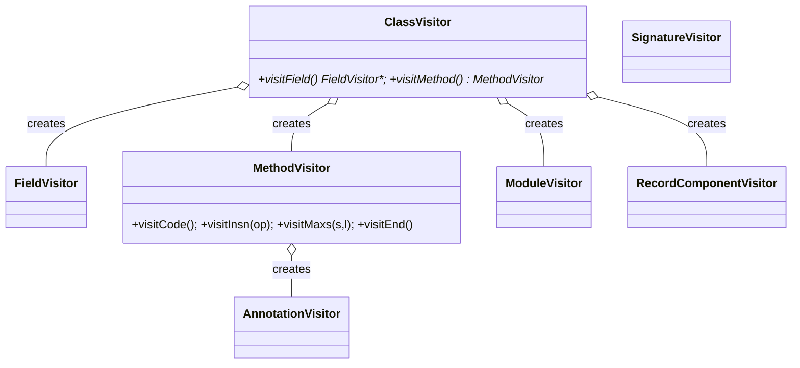
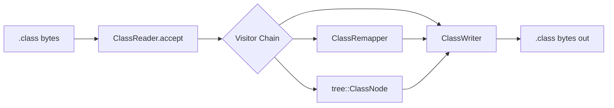
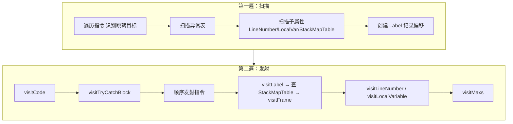
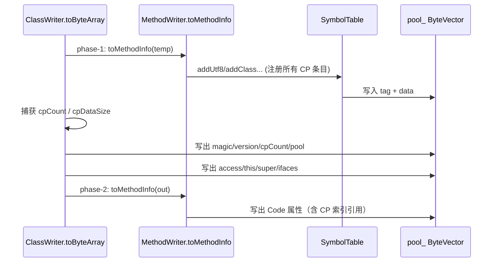

# Core API 设计

## 概述

Core API 提供 Java `.class` 文件的二进制解析与生成，基于 **Visitor 模式**（`jbytecode::core`）。
对标 ASM 的 `org.objectweb.asm` 顶层 API。命名空间：`jbytecode::core`。

## Visitor 层次与事件流

所有 visitor 使用**委托模式**：每个类持有一个 `delegate` 指针，默认实现转发给 delegate，
delegate 为 `nullptr` 时退化为 no-op（工厂方法返回 `nullptr`）。这是 visitor 链透明变换的基础。



## 整体执行流程



## 二遍扫描（Code 属性解析）

`ClassReader` 内部用二遍扫描解析 Code 属性：



## 常量池两阶段序列化

与 ASM Java 不同，常量池由独立的 `SymbolTable`（而非 `ClassWriter`）管理。
`SymbolTable` 负责 CP 条目注册 + 去重，序列化字节缓存在 `ClassWriter::pool_`。
因此 reader -> writer 输出不保证复现 ASM Java 的常量池顺序或属性布局；稳定契约是
class 结构和指令语义一致，详见 [安全指南的 round-trip 边界](safety.md#round-trip-验证边界)。



## 标签正向引用回填


## 栈帧计算（COMPUTE_FRAMES）

`ClassWriter(COMPUTE_FRAMES)` 启用自动栈帧计算，在 `toByteArray()` 时对每个方法做
数据流分析，生成优化编码的 StackMapTable 属性。`COMPUTE_FRAMES` 隐式包含 `COMPUTE_MAXS`。

实现结构与 ASM Frame.java 对齐（`Frame` / `CurrentFrame` 类 + `computeAllFrames()`
fixpoint），不是简化版。能正确处理 javac 生成的全部合法字节码。worklist 带迭代预算，
不收敛时抛 `FrameComputationException`，避免继承环或病态 provider 导致进程卡死。

### 算法：两步法 + worklist fixpoint

```mermaid
flowchart TD
    A["构造隐式第一帧<br/>setInputFrameFromDescriptor"] --> B[accept 第一帧]
    B --> C{worklist 非空?}
    C -->|是| D[取一个基本块]
    D --> E[遍历 outgoingEdges]
    E --> F["frame.merge(successor, edgeInfo)"]
    F --> G{successor 帧改变?}
    G -->|是| H[successor 加入 worklist]
    G -->|否| E
    H --> C
    C -->|否| I[遍历所有基本块]
    I --> J{可达 + 跳转目标?}
    J -->|是| K[frame.accept 写出 StackMapTable"]
    J -->|不可达| L["NOP+ATHROW 替换死代码<br/>+ 注入 Throwable 帧"]
```

对应 `MethodWriter::computeAllFrames()`（method_writer.cpp，对齐 ASM L1560-1658）：

1. **CFG 构建** —— 把每个异常处理器范围转成 `Edge(catchType, handlerBlock)`，挂到范围内
   各基本块的 `outgoingEdges`。
2. **第一帧** —— `setInputFrameFromDescriptor(access, descriptor, maxLocals)`：构造器填
   `UNINITIALIZED_THIS`，普通方法填 `this` 类型，按描述符填参数。
3. **Fixpoint** —— worklist 上反复 `merge()`，直到无基本块再变化。`merge()` 在汇聚点
   合并 locals/stack，对象类型用 `ICommonSuperClassProvider` 求公共父类。
4. **死代码处理** —— 不可达基本块的字节被替换为 `NOP...ATHROW` 并补一个 `Throwable` 帧
   （与 ASM 完全一致）。

### AbstractType —— 单 int 类型编码（ASM Frame.java L137-190）

```cpp
// 单 int 编码: DIM(6bit) | KIND(4bit) | FLAGS(2bit) | VALUE(20bit)
// KIND:  CONSTANT_KIND(1) | REFERENCE_KIND(2) | UNINITIALIZED_KIND(3)
//        FORWARD_UNINITIALIZED_KIND(4) | LOCAL_KIND(5) | STACK_KIND(6)
//
// 关键：输出帧用 LOCAL_KIND|idx / STACK_KIND|pos 表示
//       "输入帧 locals[idx]/stack[pos] 的类型"，在输入帧未知时也能算输出帧
int t = Frame::INTEGER;                 // CONSTANT_KIND | ITEM_INTEGER
int t = Frame::REFERENCE_KIND | classIdx;  // 对象引用
int t = Frame::ARRAY_OF | Frame::INTEGER;  // [I
```

- `getConcreteOutputType()` 把输出帧里的 `LOCAL_KIND`/`STACK_KIND` 解析回具体类型
  （在 `merge()` 中调用）。
- `getLocal/setLocal/push/pop` 维护输出帧的 locals/stack。

### 构造器与 NEW 初始化链

- 构造器首帧 `this = UNINITIALIZED_THIS`。
- `INVOKESPECIAL <init>` 触发 `addInitializedType(被初始化的对象类型)`，
  记录一次初始化事件。
- `merge()` 时对输出帧里的 UNINITIALIZED 类型调用 `getInitializedType()`：
  若匹配某次初始化事件，替换为具体类类型（`UNINITIALIZED_THIS` → 当前类名；
  `NEW` 产生的 → `NEW` 指令对应的类）。

### 公共父类接口（ICommonSuperClassProvider）

`merge()` 合并两个不同非数组对象类型时，需要它们的公共父类。实现
`ICommonSuperClassProvider` 提供精确的运行时类层次：

```cpp
class MyProvider : public core::ICommonSuperClassProvider {
    ca::str::Utf8StringRef getCommonSuperClass(
        const ca::str::Utf8StringRef& t1,
        const ca::str::Utf8StringRef& t2) override {
        return ca::str::Utf8StringRef::from_cstr("java/lang/Number");  // 用 Class.forName 或预计算表
    }
};
MyProvider                provider;
ca::str::Utf8StringArena arena;
ClassWriter               cw(arena, ClassWriter::COMPUTE_FRAMES);
cw.setTypeResolver(&provider);
```

默认 `DefaultCommonSuperClassProvider` 内置常见 JCL 类的小型继承表
（Number/Throwable/Exception/Error/RuntimeException/IndexOutOfBoundsException 等），
表外类型退化为 `java/lang/Object`。对绝大多数 javac 输出足够；若要精确处理
任意第三方库的类层次，注入自定义 provider。

### StackMapTable 优化编码

`MethodWriter::putFrame()` 把每条帧编码为最紧凑格式：

| 格式 | 帧类型值 | 条件 |
|------|---------|------|
| SAME | 0-63 | 局部变量未变, 栈为空, delta ≤ 63 |
| SAME1 | 64-127 | 局部变量未变, 栈 1 项, delta ≤ 63 |
| SAME_FRAME_EXTENDED | 251 | 局部变量未变, 栈为空, delta > 63 |
| SAME1_EXTENDED | 247 | 局部变量未变, 栈 1 项, delta > 63 |
| CHOP | 248-250 | 局部变量减少 k (1-3), delta ≤ 63 |
| APPEND | 252-254 | 局部变量增加 k (1-3), delta ≤ 63 |
| FULL_FRAME | 255 | 以上均不满足, 全量描述 |

实现时先修剪尾部 TOP locals 再比较前后帧差异。

### 局限

1. **JSR/RET** — 不支持。`COMPUTE_FRAMES` 模式遇到 JSR/RET 抛
   `std::invalid_argument`（与 ASM 相同限制）。用 `JsrInlinerAdapter` 先内联消除。
2. **公共父类的精度** —— 默认 provider 只覆盖 JCL 常见类，自定义类层次需注入
   `ICommonSuperClassProvider`（见上）。

Tree 回放的事件顺序、迭代器失效和线程安全约束统一记录在
[安全使用指南](safety.md)，不在各 API 文档中重复维护。

## 关键 API

### ClassReader

```cpp
ClassReader(ca::str::Utf8StringArena& arena, const ca::u8* buf, ca::i32 len); // 借用 buf，不复制
ClassReader(ca::str::Utf8StringArena& arena, const std::string& path);         // 从文件
ClassReader(ca::str::Utf8StringArena& arena, std::istream& is);                // 从流

ca::i32                getAccess() const;
ca::str::Utf8StringRef getClassName();
ca::str::Utf8StringRef getSuperName();
std::vector<ca::str::Utf8StringRef> getInterfaces();

void accept(ClassVisitor* cv, ca::i32 parsingOptions);
void accept(ClassVisitor* cv, Attribute* prototypes, ca::i32 parsingOptions);

// parsingOptions: SKIP_CODE | SKIP_DEBUG | SKIP_FRAMES | EXPAND_FRAMES
```

### ClassWriter

```cpp
ClassWriter(ca::str::Utf8StringArena& arena);                    // maxs/frames 由调用方提供
ClassWriter(ca::str::Utf8StringArena& arena, int flags);         // flags = COMPUTE_MAXS | COMPUTE_FRAMES

void setTypeResolver(ICommonSuperClassProvider* r);  // 注入公共父类解析器
std::vector<ca::u8> toByteArray();                    // 序列化（触发 phase-1/phase-2）
```

### MethodVisitor（核心事件顺序）

```
visitCode()
  → [visitTryCatchBlock ...]
  → visitInsn / visitVarInsn / visitFieldInsn / visitMethodInsn / visitJumpInsn / visitLabel / visitFrame ...
  → visitLocalVariable ...
  → visitMaxs(maxStack, maxLocals)
visitEnd()
```

### 辅助类型

| 类 | 作用 |
|----|------|
| `Opcodes` | 逻辑操作码 + ASM API 版本 + 类版本（V1_1 ~ V27） |
| `Type` | 类型描述符解析（`getType` / `getMethodDescriptor` / `getArgumentsAndReturnSizes`） |
| `Label` | 字节码偏移锚点，支持正向引用回填 |
| `Handle` | `CONSTANT_MethodHandle` 引用 |
| `ConstantDynamic` | `CONSTANT_Dynamic` 引用 |
| `SymbolTable` | 常量池注册/去重（ClassWriter 内部） |
| `Attribute` | 自定义属性的原型（可通过 `accept` 的 prototypes 参数扩展） |
| `TypePath` / `TypeReference` | 类型注解的目标定位 |

## minidemo

```cpp
// 读取 → 修改 → 写出
ca::str::Utf8StringArena arena;
ClassReader              reader(arena, data, len);
ClassWriter              writer(arena, ClassWriter::COMPUTE_MAXS);
reader.accept(&writer, 0);    // 直通回放（无修改）
std::vector<ca::u8> result = writer.toByteArray();

// 或者通过 Tree API 修改后再写
tree::ClassNode cn;
reader.accept(&cn, 0);
// ... 修改 cn ...
cn.accept(&writer);
```
