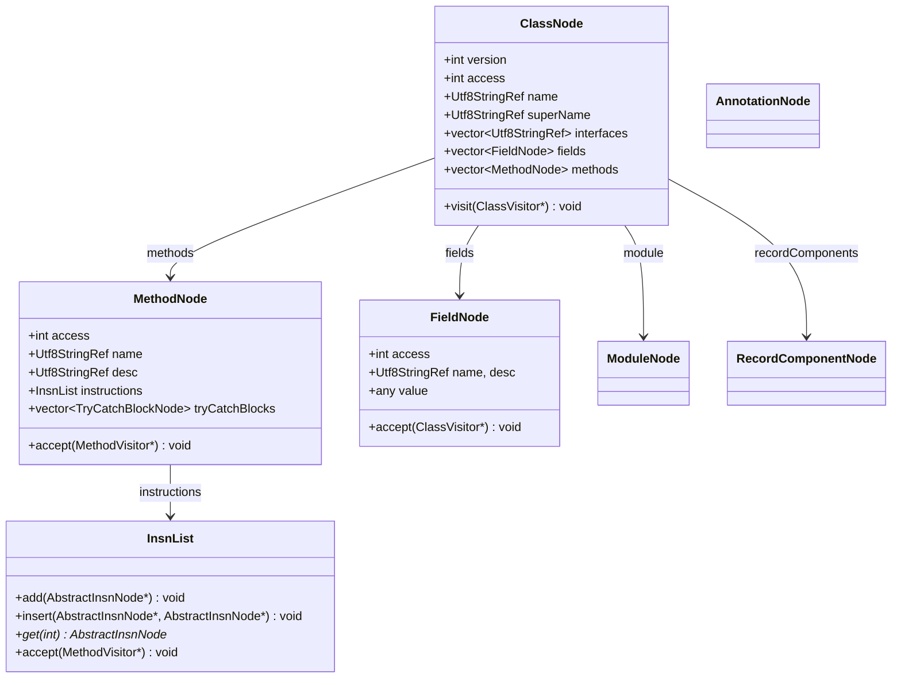
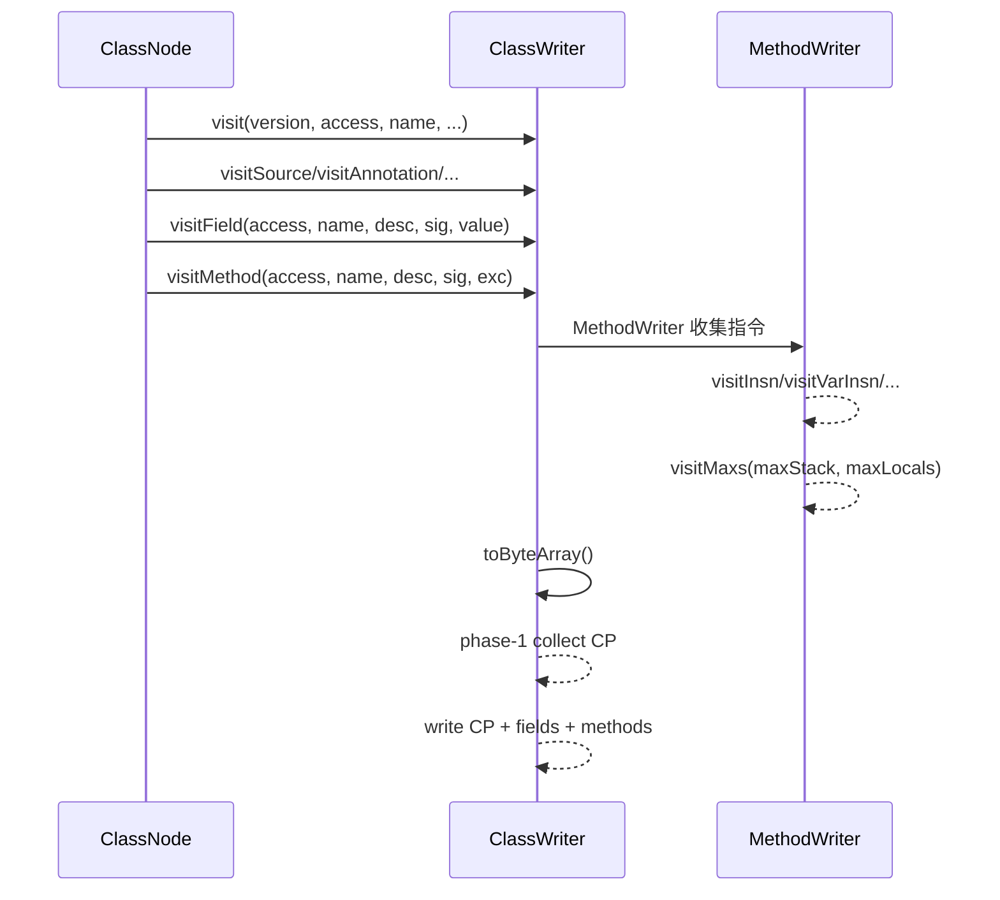

# Tree API 设计

## 概述

Tree API 在 Core API 之上提供内存中的完整 class 树形表示（`jbytecode::tree`），
支持通过 `accept(ClassVisitor*)` 回放到 Core API 的 Visitor 链。对标 ASM 的
`org.objectweb.asm.tree`。

## 类节点结构



## 指令节点继承体系

```mermaid
classDiagram
    class AbstractInsnNode {
        +int opcode
        +AbstractInsnNode* previousInsn
        +AbstractInsnNode* nextInsn
        +accept(MethodVisitor*) void
    }
    class InsnNode { +int opcode }
    class IntInsnNode { +int operand }
    class VarInsnNode { +int var }
    class TypeInsnNode { +Utf8StringRef desc }
    class FieldInsnNode { +Utf8StringRef owner, name, desc }
    class MethodInsnNode { +Utf8StringRef owner, name, desc; bool isInterface }
    class InvokeDynamicInsnNode { +Utf8StringRef name, desc; Handle bsm; vector~any~ bsmArgs }
    class JumpInsnNode { +core::Label* label }
    class LabelNode { +core::Label* label }
    class LdcInsnNode { +any cst }
    class IincInsnNode { +int var, incr }
    class TableSwitchInsnNode { +int min, max; core::Label* dflt; vector~Label*~ labels }
    class LookupSwitchInsnNode { +core::Label* dflt; vector~int~ keys; vector~Label*~ labels }
    class MultiANewArrayInsnNode { +Utf8StringRef desc; int dims }
    class FrameNode { +int frameType; vector~any~ local, stack }
    class LineNumberNode { +int line; core::Label* start }
    AbstractInsnNode <|-- InsnNode
    AbstractInsnNode <|-- IntInsnNode
    AbstractInsnNode <|-- VarInsnNode
    AbstractInsnNode <|-- TypeInsnNode
    AbstractInsnNode <|-- FieldInsnNode
    AbstractInsnNode <|-- MethodInsnNode
    AbstractInsnNode <|-- InvokeDynamicInsnNode
    AbstractInsnNode <|-- JumpInsnNode
    AbstractInsnNode <|-- LabelNode
    AbstractInsnNode <|-- LdcInsnNode
    AbstractInsnNode <|-- IincInsnNode
    AbstractInsnNode <|-- TableSwitchInsnNode
    AbstractInsnNode <|-- LookupSwitchInsnNode
    AbstractInsnNode <|-- MultiANewArrayInsnNode
    AbstractInsnNode <|-- FrameNode
    AbstractInsnNode <|-- LineNumberNode
```



## InsnList

`InsnList` 是双向链表，节点由 `previousInsn` / `nextInsn` 链接。提供索引访问（O(n)）
和迭代器遍历。**迭代中修改链表需遵守失效规则**，详见
[安全使用指南](safety.md#insnlist-迭代器失效规则)。

## 回放机制

`ClassNode::accept` 与 `ClassReader::accept` 的事件顺序并不完全相同；visitor 若依赖事件
顺序，必须遵守 [Accept 链契约](safety.md#accept-链契约)。当前回放要求完整保留 class
结构和指令语义，不承诺输出字节与 ASM Java 完全一致。



## 关键 API

### ClassNode

```cpp
tree::ClassNode cn;
reader.accept(&cn, /*parsingOptions=*/0);   // 从 ClassReader 填充
cn.accept(&writer);                          // 回放到 ClassVisitor
```

### MethodNode

```cpp
class MethodNode : public MethodVisitor {
    InsnList instructions;
    std::vector<TryCatchBlockNode*> tryCatchBlocks;
    std::vector<LocalVariableNode*> localVariables;
    int maxStack, maxLocals;
    void accept(MethodVisitor* mv);   // 顺序回放指令 + 属性
};
```

### InsnList

```cpp
class InsnList {
    void add(AbstractInsnNode* n);                              // 尾插
    void insert(AbstractInsnNode* loc, AbstractInsnNode* n);    // 在 loc 前插
    void insert(AbstractInsnNode* n);                           // 头插
    void set(AbstractInsnNode* loc, AbstractInsnNode* n);       // 替换（arena 节点只摘链，堆节点 delete）
    void remove(AbstractInsnNode* n);                           // 只摘链，不销毁
    void removeAndDelete(AbstractInsnNode* n);                  // 摘链并销毁堆节点（arena 节点只摘链）
    template <class T, class... Args>
    T* create(Args&&... args);                                  // 在 owner arena 上建节点
    AbstractInsnNode* getFirst() / getLast();
    AbstractInsnNode* get(int index);
    int size();
    void accept(MethodVisitor* mv);                             // 顺序回放
    std::vector<AbstractInsnNode*> toArray();                   // 快照（迭代修改用）
};
```

## minidemo

```cpp
// 读取到树、修改、回写
ca::str::Utf8StringArena arena;
tree::ClassNode          cn;
ClassReader              reader(arena, data, len);
reader.accept(&cn, 0);

// 在方法开头插入指令：节点由方法 arena 分配，寿命随 MethodNode
tree::MethodNode* m = cn.methods[0];
m->instructions.insert(m->instructions.getFirst(),
    m->instructions.create<tree::InsnNode>(Opcodes::ACONST_NULL));

// 回写
ClassWriter writer(arena);
cn.accept(&writer);
auto result = writer.toByteArray();
```
