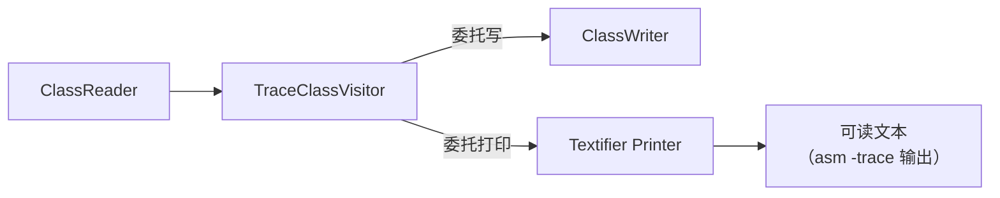

# Util 设计

## 概述

Util（`jbytecode::util`）提供调试/追踪/验证工具，基于 Printer 模式。
对标 ASM 的 `org.objectweb.asm.util`。

## Printer 模式

`Printer` 是一个**与 Visitor 镜像的事件接收器**：每个 `visitXxx` 对应一个虚方法，
收集文本到 `text` 向量。`Textifier` / `ASMifier` 是 Printer 的两个具体实现。



## 类关系

| 类 | 作用 |
|----|------|
| `Printer` | 事件 → 文本的抽象基类（visit/visitField/visitMethod ... 与 Visitor 镜像） |
| `Textifier` | 生成**人类可读**的字节码清单（指令、属性、注解） |
| `ASMifier` | 生成**等价 ASM API 调用**的 Java/C++ 源码 |
| `TraceClassVisitor` | ClassVisitor 装饰器：同时转发到真实 visitor 和 Printer |
| `TraceSignatureVisitor` | 解析并打印泛型签名 |
| `CheckClassAdapter` / `CheckMethodAdapter` / `CheckFieldAdapter` / `CheckAnnotationAdapter` / `CheckModuleAdapter` / `CheckRecordComponentAdapter` / `CheckSignatureAdapter` | 运行时校验事件序列合法性（非法 visit 顺序、非法参数） |
| `CheckFrameAnalyzer` | 用 Analysis 引擎做字节码验证 |

## 关键 API

### TraceClassVisitor（打印字节码）

```cpp
ClassReader reader(data, len);
ClassWriter writer;

util::Textifier textifier;
util::TraceClassVisitor tcv(&writer, &textifier);   // cv + printer
reader.accept(&tcv, 0);

// 文本在 textifier.text（按行）或 textifier.stringBuilder（累积）
for (const auto& line : textifier.getText()) {
    printf("%s\n", line.c_str());
}
```

### ASMifier（生成等价代码）

```cpp
ClassReader reader(data, len);
util::ASMifier asmifier;
util::TraceClassVisitor tcv(/*cv=*/nullptr, &asmifier);
reader.accept(&tcv, 0);

// asmifier.text = 等价的 ASM API 调用序列
```

### CheckClassAdapter（验证）

```cpp
ClassReader reader(data, len);
ClassWriter writer;
util::CheckClassAdapter cca(&writer);   // 非法事件序列/参数抛 std::runtime_error
reader.accept(&cca, 0);
```

## minidemo

```cpp
// 打印任意 .class 的可读清单
ClassReader reader(data, len);
util::Textifier textifier;
util::TraceClassVisitor tcv(nullptr, &textifier);
reader.accept(&tcv, /*parsingOptions=*/0);
for (const auto& line : textifier.getText()) {
    printf("%s\n", line.c_str());
}
```
